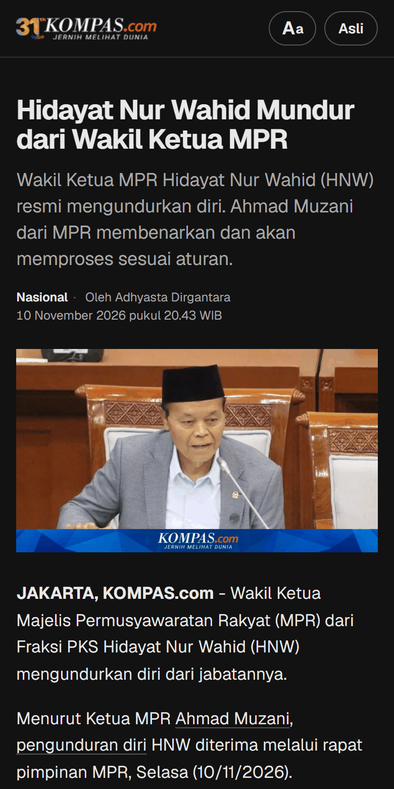
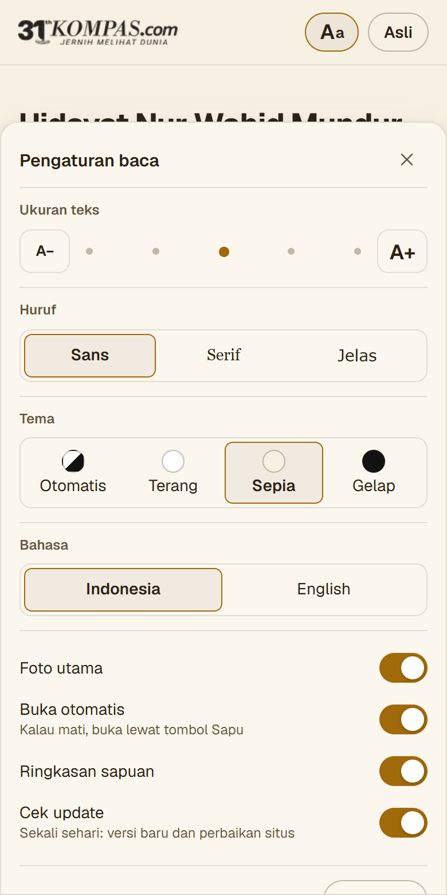

# Sapu Berita

**Read Indonesian news in peace.** No ads, no "Baca Juga" link lists in the middle of the story, and multi-page articles merged into one.

[Install page](https://dhantyo.github.io/sapu-berita/) · [Download](../../releases/latest) · [Android](docs/install-android.md) · [iPhone, iPad, Mac](docs/install-apple.md) · [Supported sites](#supported-sites)

  

> **Beta.** Sapu Berita is still early (0.x). If an article looks wrong, [report it](../../issues/new/choose) with the link.

## What it does

- **Removes the clutter:** ads, "Baca Juga" (read also) link lists, share buttons, Google News and newsletter prompts.
- **Merges pages:** articles split over 2, 3 or 5 pages appear whole, on one page.
- **Tidies summaries:** editor summary boxes ("Ringkasan Berita", key points) become one clean list.
- **Keeps what matters:** photos, captions, and social media posts that are part of the story.
- **Shows the outlet's logo**, taken from the site itself, so you always know who you're reading.
- **Your way:** text size, font (serif, sans, extra-legible), light, sepia or dark theme, Indonesian or English interface.

The **Original** button always takes you back to the publisher's page.

## Install

| Device | How it works | Guide |
|---|---|---|
| **Android** | A small app that opens news links from WhatsApp, Telegram and other apps straight in the clean view. Your browser stays as it is. | [Android guide](docs/install-android.md) |
| **iPhone, iPad** | A Safari bookmark today, an Apple Shortcut (Share → Sapu Berita) soon. Always the latest version. | [Apple guide](docs/install-apple.md) |
| **Mac** | One button in Safari's Favourites bar. Always the latest version. | [Apple guide](docs/install-apple.md) |
| **Chrome, Brave, Edge, Firefox** (desktop) | The same one-click bookmark, or an extension that runs automatically. | [Install page](https://dhantyo.github.io/sapu-berita/), [extension guide](apps/extension/README.md) |

The [install page](https://dhantyo.github.io/sapu-berita/) picks the right steps for your device. All downloads are also on the [Releases](../../releases/latest) page.

## Supported sites

Detik · Kompas · Tribunnews (including regional sites) · CNN Indonesia · CNBC Indonesia · Liputan6 · Merdeka · Suara · Okezone · Viva · iNews · JPNN · ANTARA · Republika · Bisnis.com · Tirto

**Not yet:** Tempo (paywalled; Sapu Berita doesn't bypass paywalls), Kumparan, Sindonews, IDN Times. Want another site? [Suggest it](../../issues/new/choose).

## Updates

Sapu Berita tells you when there's a new version: a small "Sapu Berita X is available · Update" box appears above the article.

- **Site fixes** (when a news site changes its layout) arrive automatically, without updating the app.
- **Android:** tap **Update** → the new APK downloads → open it → **Update**. Your settings are kept.
- **iPhone, iPad, Mac:** nothing to do. The Shortcut and the bookmark always run the newest version.
- **Extension:** tap **Update** → download the new zip, replace the old folder, click ↻.

## Privacy

Everything runs on your device. Sapu Berita has no server, no analytics, and doesn't know what you read. Articles still load from the publisher's own site, so your visit counts for them as usual.

Once a day it downloads two small files from GitHub: the latest version number and the latest site rules. Nothing about you or your reading is sent. You can turn it off under **Aa → Check for updates**.

## Contributing

News sites change their layouts often, so the per-site rules need care. Reporting a broken article already helps a lot: open **Aa → Report it** on that article. To work on code or rules, see [CONTRIBUTING.md](CONTRIBUTING.md) and [docs/DEVELOPING.md](docs/DEVELOPING.md).

## License

[GPL-3.0](LICENSE). Ad filters and pagination rules are derived from [AdBlockID](https://github.com/realodix/AdBlockID), [ABPindo](https://github.com/ABPindo/indonesianadblockrules) and [AutoAllPage](https://github.com/reforget-id/AutoAllPage) (all GPL-3.0). Sapu Berita is not affiliated with any news outlet; their names and logos belong to their owners.

Part of the **Sapu** family, alongside Sapu Buzzer (coming soon).
